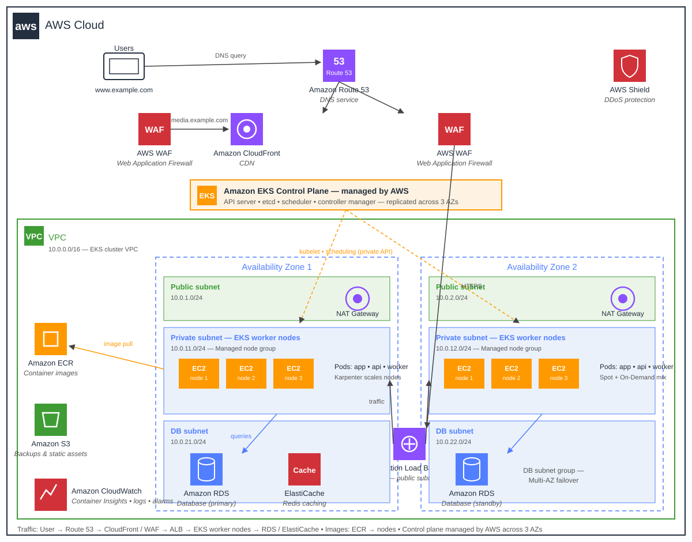

# Amazon EKS — Kubernetes, Managed the AWS Way

[](https://aws.amazon.com/eks/)
[](https://kubernetes.io/)
[](LICENSE)
[](#)

> **TL;DR:** Amazon EKS runs the Kubernetes control plane for you — highly available across 3 AZs, patched and upgraded by AWS — so you only manage worker nodes and workloads. This guide covers the architecture that actually survives production: private node groups, IRSA least-privilege, managed add-ons, Karpenter autoscaling, and observability wired from day one.

---

## What EKS actually gives you

| Piece | Who runs it | What you get |
|---|---|---|
| Control plane (API server, etcd, scheduler) | AWS | Multi-AZ, auto-patched, 99.95% SLA |
| Worker nodes (EC2 / Fargate) | You (or Fargate) | Your choice of instance types, scaling, AMIs |
| Networking (VPC CNI, CoreDNS, kube-proxy) | AWS add-ons | Pod IPs from your VPC, service discovery |
| IAM integration (IRSA) | You configure | Pods get scoped AWS credentials — no node-wide keys |
| Upgrades | You trigger, AWS assists | One minor version at a time, nodes after control plane |

The mental model: **EKS is Kubernetes with the hardest 20% outsourced.** You still own the workloads, the networking design, and the IAM — those are where production clusters fail.

---

## Architecture



Traffic flow: **User → Route 53 → CloudFront → WAF → ALB → EKS worker nodes (private subnets) → RDS / ElastiCache**, with container images pulled from **ECR** and everything observed by **CloudWatch + X-Ray**.

Key design decisions in the diagram:

- **Control plane spans 3 AZs** — an AZ outage never takes down the API server.
- **Worker nodes live in private subnets only.** The only public entry point is the ALB in the public subnets; NAT Gateways give nodes outbound-only internet (image pulls, patching).
- **IRSA (IAM Roles for Service Accounts)** — each pod assumes its own IAM role via the cluster's OIDC provider. A compromised pod gets *its* permissions, not the node's.
- **Managed node groups + Karpenter** — node groups for stable baseline capacity, Karpenter for fast, right-sized scale-out (it picks the cheapest instance that fits the pending pod).

---

## EKS vs the alternatives

| Option | Control plane ops | Node ops | Best for |
|---|---|---|---|
| **Amazon EKS** | AWS | You (or Fargate) | Production K8s on AWS, full ecosystem |
| Self-managed K8s on EC2 | You | You | Total control, or non-AWS parity |
| Amazon ECS | AWS | You (or Fargate) | Simpler container orchestration, no K8s API |
| EKS + Fargate | AWS | AWS (serverless) | No node management at all; spiky / small workloads |
| EKS Anywhere | You | You | On-premises clusters with the EKS console |

Rule of thumb: if your team already speaks Kubernetes, EKS. If you just need containers running with minimal ceremony, ECS.

---

## Quickstart

```bash
# 1. Create a cluster with managed node groups (eksctl does the VPC + IAM for you)
eksctl create cluster \
  --name prod-eks \
  --region ap-southeast-1 \
  --version 1.32 \
  --nodegroup-name standard-workers \
  --node-type t3.medium \
  --nodes 2 --nodes-min 2 --nodes-max 6 \
  --managed

# 2. Check the cluster and nodes
kubectl get nodes
kubectl get pods -A

# 3. Install Karpenter for autoscaling (one command via Helm)
helm upgrade --install karpenter oci://public.ecr.aws/karpenter/karpenter \
  --version 1.0.0 --namespace karpenter --create-namespace

# 4. Deploy a sample workload
kubectl create deployment demo-nginx --image=nginx:1.27
kubectl expose deployment demo-nginx --port=80 --type=LoadBalancer
kubectl get svc -w   # wait for the ALB hostname
```

`eks_demo.py` in this repo inspects a live cluster with boto3 — control-plane health, node groups, add-ons, IRSA/OIDC status, and a monthly cost estimate. Run it before any upgrade decision:

```bash
pip install boto3
python eks_demo.py --cluster prod-eks --region ap-southeast-1
```

---

## Production checklist

- [ ] Control plane **private endpoint** (or endpoint access restricted by CIDR)
- [ ] Nodes in **private subnets**, no public IPs, IMDSv2 enforced
- [ ] **IRSA** everywhere — no IAM credentials baked into nodes or images
- [ ] **Managed add-ons** pinned: VPC CNI, CoreDNS, kube-proxy, EBS CSI, GuardDuty agent
- [ ] **Pod Security Standards** enforced (baseline minimum, restricted where possible)
- [ ] **Secrets via Secrets Manager / Parameter Store** (CSI driver), never env vars in manifests
- [ ] **CloudWatch Container Insights** + Prometheus for metrics; audit logs to CloudTrail
- [ ] **Upgrade rehearsal**: control plane → add-ons → nodes, one minor version at a time
- [ ] **Pod Disruption Budgets** on every critical workload before enabling Karpenter scale-to-zero
- [ ] **Cost guardrails**: Karpenter consolidation on, right-size with Kubecost or Compute Optimizer

---

## Cost, honestly

| Item | Price (us-east-1, approx.) |
|---|---|
| Control plane | **$0.10 / hour ≈ $73 / month** per cluster |
| EC2 worker nodes | On-Demand / Spot — the real bill; use Spot + Karpenter for batch |
| EKS + Fargate pods | vCPU + memory per second, no node bill |
| NAT Gateway | $0.045 / hour + data processing — often the surprise line item |

One cluster per environment is the norm; don't create a cluster per microservice — namespaces + RBAC are cheaper.

---

## Common mistakes

1. **Public control-plane endpoint with `0.0.0.0/0`** — the #1 EKS misconfiguration. Restrict it.
2. **Nodes with broad IAM roles** — every pod inherits the node role without IRSA. Assume breach.
3. **Skipping add-on upgrades** — old VPC CNI versions silently break new features and security fixes.
4. **No Pod Disruption Budgets** — node drains during upgrades kill availability you thought you had.
5. **One node group for everything** — mix Spot for batch and On-Demand for system pods (taints + tolerations).

---

## Quiz

Think you know EKS? Five questions in [`quiz.md`](quiz.md) — control-plane HA, IRSA, Karpenter, upgrades, and node security. Answers are collapsed, try them first.

---

## Changelog

- **2026-11-22** — Initial guide: architecture, quickstart, production checklist, quiz.
